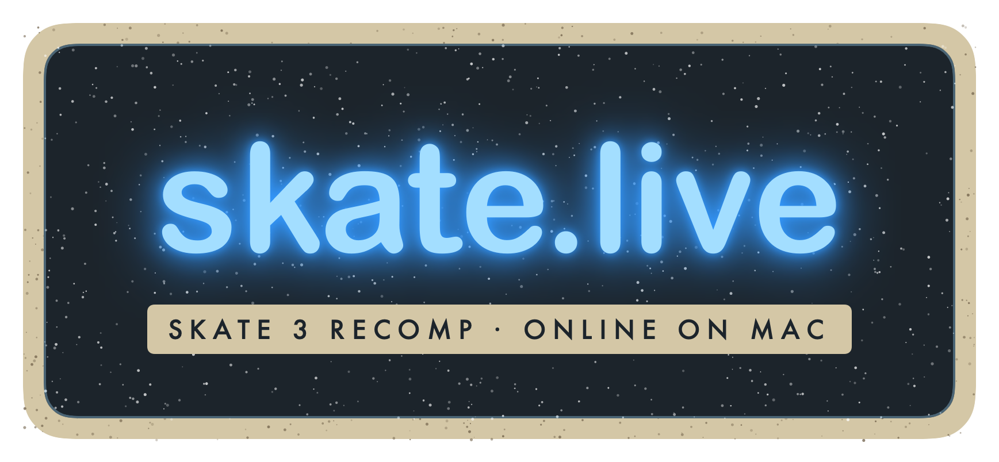

<p align="center">
  
</p>

<h3 align="center">Skate 3 online again, for skate3recomp on Mac</h3>

<p align="center">
  <a href="../../releases">Download</a> ·
  <a href="#build-from-source">Build from source</a> ·
  <a href="docs/TECHNICAL.md">How it works</a>
</p>

---

Skate.live brings back **online freeskate** for the [skate3recomp](https://github.com/mchughalex/skate3recomp) macOS release. EA's Skate 3 servers are gone. Instead, one player's Mac runs a small replacement server and everyone's game connects to it. No EA account is needed. It works on a local network or over [Tailscale](https://tailscale.com) with friends anywhere.

> **Unofficial.** Not affiliated with or endorsed by Electronic Arts, the skate3recomp project or Microsoft. Skate.live doesn't include or modify any game files.

## You need

- **skate3recomp 2.0.2 for macOS**, installed by you from [its releases](https://github.com/mchughalex/skate3recomp/releases), plus the game files from **your own Xbox 360 copy of Skate 3**, as described in skate3recomp's README. Skate.live doesn't install it for you.
- An Apple Silicon Mac.
- For the host: Python 3. `/usr/bin/python3` comes with the Xcode Command Line Tools (`xcode-select --install`).

## Install

1. Download `Skate.live.dmg` from [Releases](../../releases), open it and drag **Skate.live** (and **Skate.live Server**, if you plan to host over Tailscale) into Applications.
2. The apps aren't notarized, so macOS blocks the first launch. Right-click → **Open** → **Open**, or allow them under System Settings → Privacy & Security.

Skate.live looks for `skate3recomp.app` in Applications, `~/Applications` and `~/Downloads/Skate3Recomp-macOS/`. If it isn't there, you can choose it in the launcher.

## Play on the same network

1. Everyone opens **Skate.live** and sets **Your Name**, which is what the others see online.
2. **The host** picks **Host** and presses **Launch Skate 3**. This starts the server too. Pressing **Start** first lets friends' launchers find it early.
3. **Friends** pick **Join**. The launcher finds the host's server by itself and shows the host's name; **Enter address** lets you type it in instead. Then press **Launch Skate 3**.
4. In game, go to **Xbox LIVE → Online Challenge Map → Freeskate**. The host picks **Create Private Freeskate**, and friends pick **Join Public Freeskate** to land in the host's session.

Everyone the server has seen shows up as a friend automatically, so there's no friend list to manage.

## Play over Tailscale

For friends who aren't on your network. Everyone joins the same tailnet.

1. The host opens **Skate.live Server**. It runs the server on the host's Tailscale IP in a Terminal window and shows that IP. Closing the window stops it.
2. **Everyone, the host included,** picks **Join** in Skate.live, types that IP and presses **Launch Skate 3**.

## Network and permissions

- macOS may ask whether Python and skate3 may accept incoming connections. Allow both.
- The launcher may ask for local network access to find the host. Allow it.
- **Ports:**
  - The server uses TCP 42127 and port 80. It also announces itself on UDP 42128.
  - Gameplay goes directly between players over UDP. The port is in `lan.log`.
- **Logs** are in `~/Library/Application Support/Skate3 LAN/`:
  - `lan.log`: the game's network layer
  - `server.log`: every server request, on the host only

## Status

Tested: two games on one Mac joined the same private freeskate. Playing across separate Macs still needs more testing, so please open an issue with your logs if something breaks.

skate3recomp 2.0.2 sometimes starts with a black screen, even without Skate.live. Quitting and starting again helps. Details are in [docs/TECHNICAL.md](docs/TECHNICAL.md#known-issue-intermittent-black-screen-at-startup).

## Build from source

You need Homebrew LLVM (`brew install llvm`), the Xcode Command Line Tools, skate3recomp 2.0.2 in `/Applications`, and a skate3recomp checkout with submodules for the headers:

```sh
git clone --recursive https://github.com/mchughalex/skate3recomp
SKATE3RECOMP=/path/to/skate3recomp ./build.sh   # dist/Skate.live.app, Skate.live Server.app, Skate.live.dmg
```

Set `SKATE3_APP=/path/to/skate3recomp.app` if it isn't in `/Applications`.

## Credits

- [skate3recomp](https://github.com/mchughalex/skate3recomp) and its rexglue SDK, which make Skate 3 run natively.
- [Skateboard3Server](https://github.com/hallofmeat/Skateboard3Server) by Hall of Meat (MIT), whose Blaze message shapes the server follows.

## License

MIT, see [LICENSE](LICENSE). Skate 3 is © Electronic Arts.
